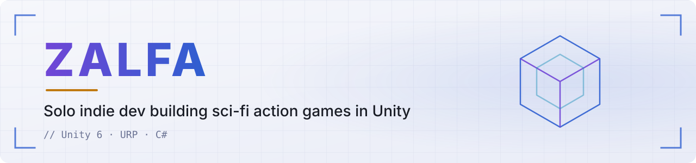
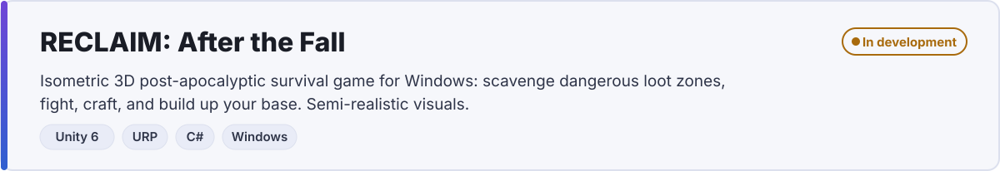
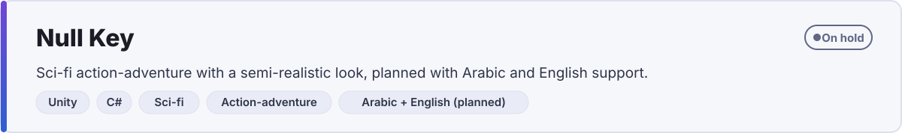

<picture>
  <source media="(prefers-color-scheme: dark)" srcset="assets/banner-dark.svg">
  
</picture>

## About

I'm Zalfa, a solo indie game developer. I build games in **Unity 6** with **C#**.
This page grows as my projects do.

## Currently building

<picture>
  <source media="(prefers-color-scheme: dark)" srcset="assets/card-reclaim-dark.svg">
  
</picture>

<picture>
  <source media="(prefers-color-scheme: dark)" srcset="assets/card-null-key-dark.svg">
  
</picture>

## Tech stack

<picture>
  <source media="(prefers-color-scheme: dark)" srcset="assets/stack-dark.svg">
  
</picture>

## Activity

<picture>
  <source media="(prefers-color-scheme: dark)" srcset="https://raw.githubusercontent.com/zayed-web/zayed-web/output/snake-dark.svg">
  
</picture>

## Contact

Follow me here on GitHub: [@zayed-web](https://github.com/zayed-web).
